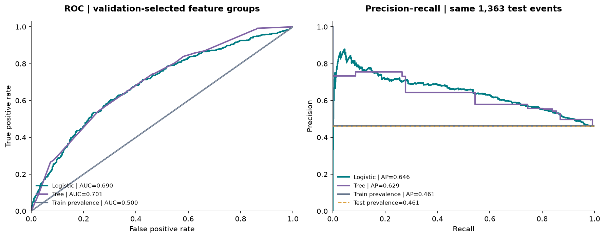
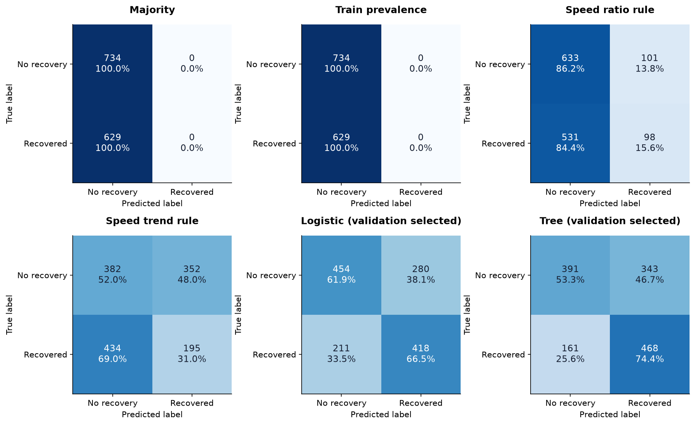
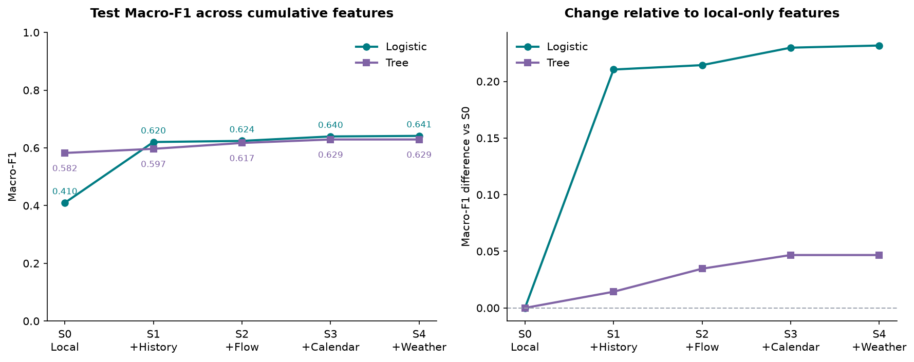
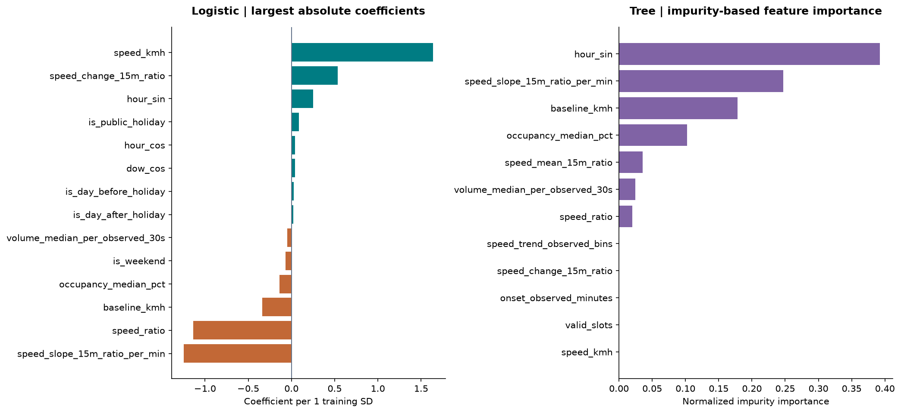

# 2026-11-01：真实重跑结果

**EXPLORATORY — NOT APPROVED AS FINAL RESULTS**

重新核验完整Release ZIP（SHA256 `53688e6e095798f50c124376da1f0f354ca4b2aedf9e83e960fef04fc7298bc9`）、95份缓存来源，重新生成历史速度、流量/占有率、官方日历和温度/风速特征，再拟合逻辑回归与决策树。

- 7597个车道事件，6799个已知30分钟标签；train/validation/test分别3428/2008/1363。
- 四个基准加两类模型×五组特征，共14个实验臂、95186条预测。
- 验证集log loss选择：`decision_tree / local+history+flow+calendar`；测试Macro-F1 **0.6290**、balanced accuracy **0.6384**、ROC-AUC **0.7007**、log loss **0.6264**。
- 22个代码单元全部执行；新旧指标一致。这是此前已查看测试集上的复现，不是新的独立盲测。

## 直接查看

[完整训练及图表Notebook](../../../notebooks/03_Tianhao_真实重跑与模型可视化.ipynb) · [离线核验Notebook](../../../notebooks/02_Tianhao_真实模型与外部特征实验.ipynb)

## 文件

`predictions.parquet` 是新运行的逐事件预测；`metrics_summary.csv` / `metrics.csv`、`confusion_matrices.csv`、`tuning.csv`、`interpretation.csv`、`feature_group_comparisons.csv`、`error_groups.csv` 是可复核的轻量表。
`original_rerun_manifest.json` / `original_source_checks.json` 保留原本地重跑证据，里面列出的完整输入/模型/代码快照未随轻量包上传。

核验：`uv run --locked python experiments/tianhao/verify_shared_results.py`。
来源下载与完整训练命令见 [实验README](../README.md)。

恢复确认与proposal恢复开始不同；日历组不能单归因于假期，京士柏是区域代理，没有雨量/事故/活动/经验证邻路实验，没有显著性或因果结论。
