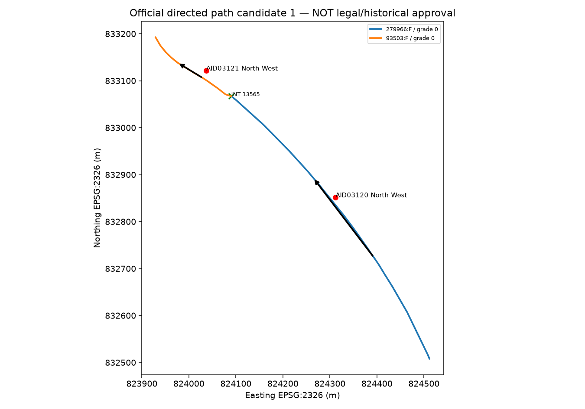
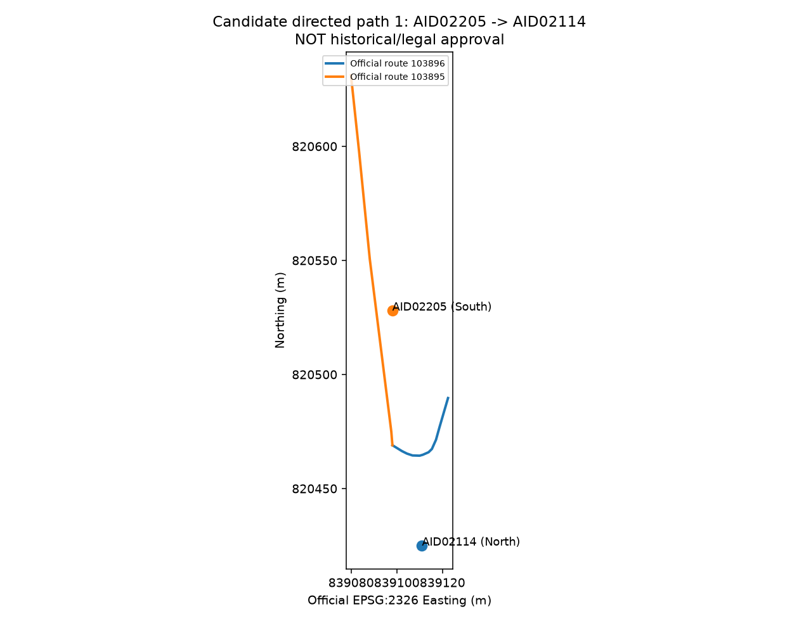

# Inferred-v2 network and retrospective experiment (2026-11-05)

**NOT an independently validated road network.** PR #20's strict historical/physical study remains NO-GO. This is a separate retrospective proxy-network experiment with original 2026-10 official CENTERLINE/INTERSECTION/TURN and 2023–2026 expanded96 observations. The original Proposal's *recovery start* target differs from the provisional `recovery_confirmation_v1` target used here. No approval or historical validity has been imputed.

## Reproduction (from repository root; destinations must not exist)

```text
uv sync --locked
uv run --locked pytest
uv run --locked python scripts/spatial96_inferred_v2.py
uv run --locked python scripts/spatial96_inferred_controls.py
uv run --locked python scripts/spatial96_inferred_figures.py
```

Prerequisites: the original, hash-verified expanded96 Release and extracted `prepared-v1/`, `data/local/network-full/v1/`, PR #20's report and ignored `data/local/spatial96/v1/candidate_path_evidence.parquet`, and the SHA-verified frozen expanded96 history features from `model-a0-a2-v2`. The experiment checks Release ZIP + all member hashes, official sources, SQLite row counts and frozen history checksum before reading features. New outputs are refused if directories already exist; use a fresh version for reruns. Input hashes: [source_sha256.json](source_sha256.json). Output hashes: [output_sha256.json](output_sha256.json). Ignore raw and feature Parquet locally; reports are reviewable in Git. Python 3.12/locked uv dependencies. Scripts are not shell-specific.

## Construction and unresolved connectivity

`inferred_directed_graph.parquet` (ignored local artifact) has **62,625** directed transitions from the official SQLite's 48,080 directed arcs. A transition requires the SAME centimetre-rounded endpoint **including source elevation**, a source INTERSECTION membership shared by both routes, no recorded TURN prohibition, and no same-route F/R U-turn. Both `TRAVEL_DIRECTION=1` and `=3` constraints are inherited from the official arcs. The SQLite records 27,513 unique arc start nodes, 72,729 intersection-route memberships and 11,100 TURN restriction records. The old paths are checked transition-by-transition against this separate filtered inferred graph; 43 P1 and 7 P2 alternative paths survive, yielding 42 and 6 canonical pairs. Path length sums travelled arc portions between road projections in metres, NOT detector-to-road offsets or straight-line distance. Canonical paths are shortest candidate paths; alternative counts retained.

**Known limitations, not silently repaired:** source INTERSECTION membership does not establish legal turning or signal phase; absent TURN prohibition is unknown, not permitted. The conservative source TURN blocking can reject conditionally legal turns. Endpoints with sub-centimetre differences, offset parallel carriageways and interior intersections not split in the source SQLite may still be disconnected. Interior geometric crossing is *never* automatically a legal traversable node. Detector heights are unknown; road grade matching is only a road-to-road check. Same-route continuation across two distinct physical route IDs requires shared INTERSECTION evidence; same route's opposite arc is blocked. No claim of complete interior splitting, legal-turn routing, real junction reachability or 2023 historical routing is made. These issues require independent investigation, not an official mapping table prerequisite for **this exploratory** study.

## Map matching (fixed before models)

All 736 original nearby point/arc candidates are retained in `mapping_scores.parquet` including direction-incompatible ones. Score = point-line distance/50m + local tangent bearing error/45° + 0.5 if detector road description does not contain official name + 0.5 for nonzero road elevation + 0.5 if detector metadata compass disagrees; incompatible travel direction gets infinite score. Best compatible arc by score, distance, arc ID, with next-compatible score margin; score is **not** calibrated probability. High-confidence requires best rank, distance <=25m, tangent error <=30°, exact name-evidence match, grade=0, metadata direction agreement, margin >=0.2. Otherwise compatible is ambiguous. Results: 27 high-confidence / 68 ambiguous / 1 direction-incompatible unmatched compatible mapping; 95 compatible mapping candidates **are not 95 correct maps**. P1 uses best compatible mapping, source-junction paths and explicit turn/grade/direction filters; P2 requires high tier on both endpoints. Both remain inferred. See [map_matching_quality.csv](map_matching_quality.csv); 80 units have multiple compatible alternatives in PR #20's raw candidates. No outcome/test score used for match selection. Confidence tiers are heuristic and susceptible to parallel carriageway and missing historical geometry.





Both are byte-for-byte labeled copies of PR #20's official-geometry review figures (`ranked-directed-pair-1.png`, `pair-1.png`), **not** newly human-reviewed or historically confirmed. Source PNG SHA-256 and copied hashes are printed by the figures script. In particular AID02205→AID02114's ~43m route path with ~45m offsets on both detectors is a cautionary example, not P2 evidence.

## Observations and evaluation

`event_neighbor_lineage.parquet` contains 29,299 **real event-neighbor** observations across both populations (P1 28,056 rows/17,550 events; P2 1,243 rows/1,182 events). Each records target unit, neighbor unit, arc and route sequences, actual network metres, observation end, bin archive closure, last raw source availability, expanded96 bins SHA-256 and mapping tier. No detector contributes twice for the same event/side. Other lanes on the target detector are excluded. Bins must be usable with non-null speed and `timestamp`, `available_at`, **and** `last_source_available_at` all <= event prediction time; maximum age 10m. Lags 5/10/15m use independently available prior bins, never future bins. Baselines for neighbor ratios must be positive and fitted no later than 2023-02-01. Missing speed/ratios/lag remain NA with count/missing indicators. Conservative 10m archive closure is a replay proxy, not proof of exact real-time availability. Multi-hop is `arc_count > 1`; 500m exponential distance decay and confidence weights 1/0.5 fixed a priori, not fitted on 2026 test results. Static structure is observed-neighbor mean network path distance (coverage-conditioned; NOT full road degree). No propagation lag is estimated.

`event_spatial_features.parquet` includes *all* events in each inferred population, with null spatial measurements where unavailable. [network_coverage_by_split.csv](network_coverage_by_split.csv) defines model eligibility as known 30m label **and** >=1 real as-of neighbor. P1 train/validation/test: **7,611 / 4,680 / 3,933**; P2: **446 / 456 / 191**. P2 has few detectors and is fragile. P3: zero independently approved connections; separate fail-closed PR #20 `neighbor_features()` retains NO-GO. No production eligibility inferred from P1/P2.

M0–M5 within each population use identical known-label eligible event IDs/splits, including independently refitted restricted-cohort M0. Fixed two-candidate RF and XGBoost search per arm; select minimum **validation** log loss, no train+validation refit, test used once for measurement, fixed probability threshold 0.5. Inputs: allowed event local features, authentic frozen history and as-of neighbor features only. `paired_spatial_metrics.csv` contains ROC-AUC, average precision (=PR-AUC), macro-F1, balanced accuracy, precision, recall, confusion counts, Brier and log loss, validation and test; `experiment_matrix.csv` logs candidate validation scores. No grouped CI, physical causal claim or statistical significance test in this version.

Controls C1–C4 on **the same P1 event IDs**: C1 nearest metadata detector within 250m EPSG:2326 (not a graph; `geographic_control_lineage.parquet` calls its distance `straight_line_distance_m`), C2 upstream/downstream pooled without direction, C3 directed P1, C4 permuted S1 within identical prediction timestamps and 5km coordinate cells (seed 42; 4,078 event rows actually swapped across the full cohort; singleton strata unchanged), C5 repeats directed P2 on its **different** subset. Each M0/M1 control is fitted with the same fixed search. Geographic and undirected controls duplicate pooled values into both side slots solely for comparable feature dimensions; they do not imply two independently observed detectors. Shuffle is partial; its apparent gains cannot falsify all broad temporal/regional confounding.

A 2026 snapshot may be wrong for 2023; detector identities, carriageways, heights, TURN conditionality and 2022 processed-network IDs remain unresolved. Increased retrospective predictive score is not evidence of valid physical/historical connectivity or deployment readiness. The original verified study and its scientific conclusions are preserved without modification.
